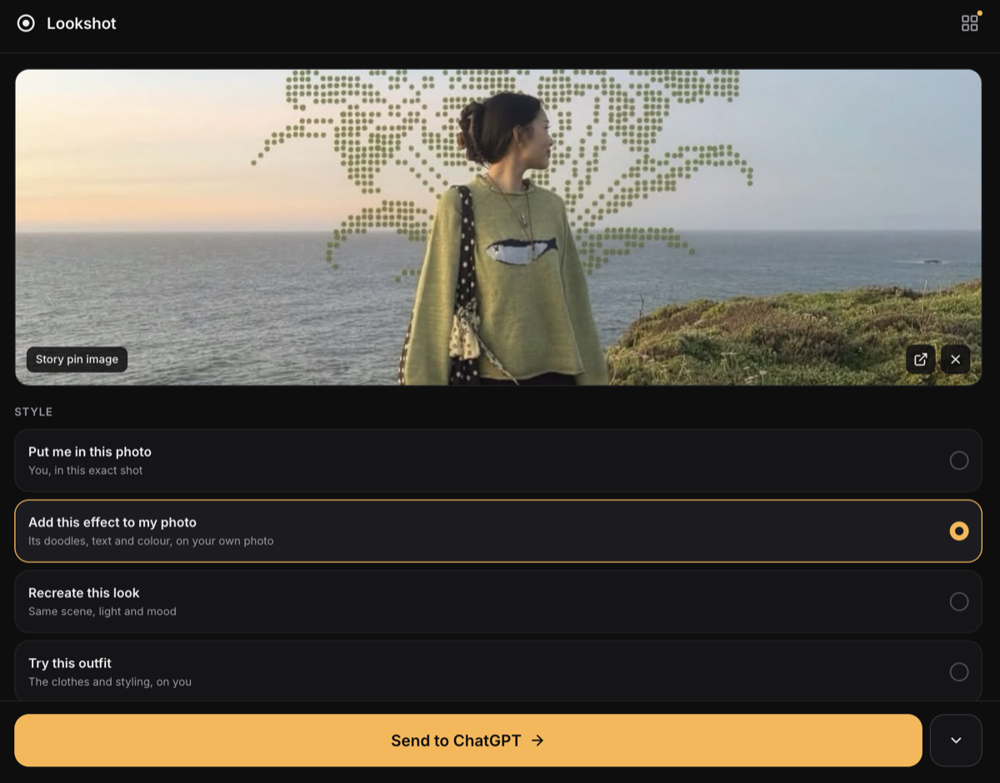

# Lookshot

**See a look you love? Put yourself in it.**

Lookshot is a Chrome extension (Manifest V3) for casual creators. Find a photo you love on Pinterest or anywhere on the web, pick a style, and Lookshot fills in a ready-to-send prompt (with the images attached) in your own ChatGPT or Gemini tab. You press send.

No account, no API keys, no Lookshot servers. Prompts are built locally in your browser.

<p align="center">
  
</p>

## Features

- **One-tap on Pinterest**: hover a pin, tap the ring, choose a style. Lookshot opens ChatGPT or Gemini and fills it in.
- **Right-click any image** on the web → *Send image to Lookshot*.
- **Four main styles**: *Put me in this photo*, *Add this effect to my photo*, *Recreate this look*, *Try this outfit*. Plus *Pro headshot*, *Travel shot* and *Your own edit* under "More styles".
- **Your photos, your consent**: add a photo of yourself, plus up to 3 more angles of your face for a closer likeness (stored only on your device, downscaled) after confirming it's you.
- **Matches the photo's shape** automatically (4:5, 9:16, 1:1, 3:2, 16:9), with lens, text and extra-direction controls under *Advanced*.
- **Gallery** of everything you've sent or copied.
- **Midjourney & Flux**: copies a text prompt (Midjourney gets the inspiration image URL as an image prompt).

## Development

```bash
npm install
npm test             # Vitest unit tests
npm run build        # type-check + build to dist/
npm run zip          # build + package dist/ as lookshot-v1.0.0.zip (Chrome Web Store upload)
```

Load in Chrome: `chrome://extensions` → enable **Developer mode** → **Load unpacked** → select the **`dist/`** folder (not the repo root). After rebuilding, click the reload button on the extension card.

## How it works

```
Pinterest pin / any image
   │  content/pinterestDetector.ts   one-tap ring + style menu (Pinterest)
   │  context menu                   right-click any image
   ▼
chrome.storage.local  ◀──────────▶  sidepanel/ (React 19 + Tailwind)
   │                                   style, your photo, advanced, send
   ▼
background/serviceWorker.ts          finds or opens the ChatGPT / Gemini tab
   ▼
content/llmInjector.ts               types the prompt, attaches the images
```

- Prompts: `src/modules/prompt-builder/` (`rulePacks.ts` holds the six styles, `builder.ts` formats per target).
- ChatGPT / Gemini page selectors live in [`config/selectors.json`](config/selectors.json). The extension refreshes them from this repo's `main` branch every few hours, so fixes for site changes ship without a store update.

## Privacy

- No analytics, no tracking, no Lookshot servers.
- Images and prompts go only to the ChatGPT or Gemini tab you choose.
- Your photos stay on your device until you remove them.
- The only network request Lookshot makes on its own is fetching `config/selectors.json` from GitHub.

Built by [Milan727](https://github.com/Milan727).
